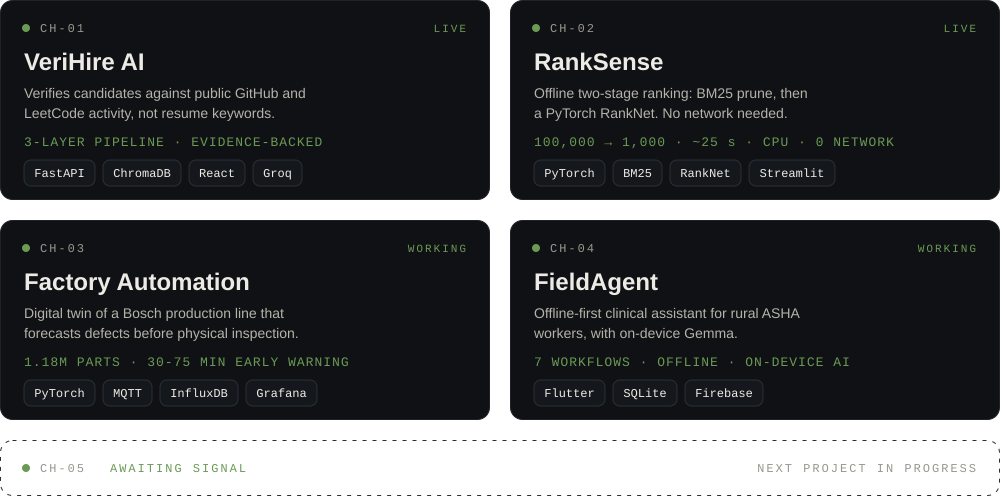

[Portfolio](https://narayan-portfolio-zv2k.vercel.app/) · [LinkedIn](https://linkedin.com/in/singhnarayan) · [Codolio](https://codolio.com/profile/Narayan_1006) · [Email](mailto:singhnarayan0866@gmail.com)

---

### `SYSTEM STATUS`

---

### `FEATURED CHANNELS`

[VeriHire AI](https://github.com/Narayan1006/VireHire) · [Live](https://vire-hire.vercel.app) &nbsp;|&nbsp; [RankSense](https://github.com/Narayan1006/RankSense) · [Live](https://huggingface.co/spaces/Narayan1006/Ranksense) &nbsp;|&nbsp; [Factory Automation](https://github.com/Narayan1006/Factory_Automation) &nbsp;|&nbsp; [FieldAgent](https://github.com/Narayan1006/FieldAgent)

---

### `STACK`

---

Currently exploring: LangChain · AI agents · Spring Boot architecture

