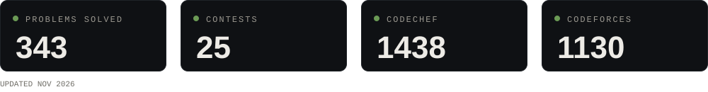
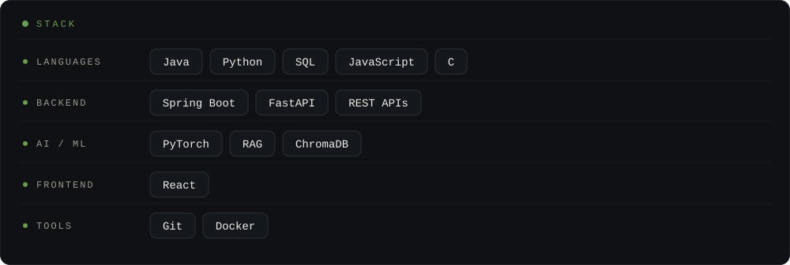

[Portfolio](https://narayan-portfolio-zv2k.vercel.app/) · [LinkedIn](https://linkedin.com/in/singhnarayan) · [Codolio](https://codolio.com/profile/Narayan_1006) · [Email](mailto:singhnarayan0866@gmail.com)

---

### `SYSTEM STATUS`

---

### `FEATURED CHANNELS`

<table>
  <tr>
    <td width="50%" valign="top">
      <b><a href="https://github.com/Narayan1006/VireHire">VeriHire AI</a></b> · <a href="https://vire-hire.vercel.app">Live</a> 
      Hiring verification against public GitHub and LeetCode activity instead of resume keywords. 
      <code>FastAPI</code> <code>ChromaDB</code> <code>React</code> <code>Groq</code>
    </td>
    <td width="50%" valign="top">
      <b><a href="https://github.com/Narayan1006/RankSense">RankSense</a></b> · <a href="https://huggingface.co/spaces/Narayan1006/Ranksense">Live</a> 
      Offline ranking of 100,000 candidates in about 25 seconds on CPU, with no network. 
      <code>PyTorch</code> <code>BM25</code> <code>RankNet</code> <code>Streamlit</code>
    </td>
  </tr>
  <tr>
    <td width="50%" valign="top">
      <b><a href="https://github.com/Narayan1006/Factory_Automation">Factory Automation</a></b> 
      Digital twin of a Bosch production line (1.18M parts) that forecasts defects 30-75 minutes early. 
      <code>PyTorch</code> <code>MQTT</code> <code>InfluxDB</code> <code>Grafana</code>
    </td>
    <td width="50%" valign="top">
      <b><a href="https://github.com/Narayan1006/FieldAgent">FieldAgent</a></b> 
      Offline-first clinical assistant for rural ASHA workers with on-device Gemma. 
      <code>Flutter</code> <code>SQLite</code> <code>Firebase</code>
    </td>
  </tr>
</table>

---

### `STACK`

---

Currently exploring: LangChain · AI agents · Spring Boot architecture

